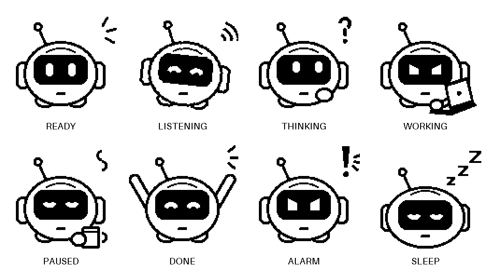

# PIP — Your Focus Companion

*A little bot. A lot of support.* PIP is an ADHD-friendly desk companion: a Waveshare
**ESP32-S3-RLCD-4.2** with a 400×300 reflective 1-bit screen, two buttons, mic and speaker, plus a
desktop app that turns brain dumps into one focus lane of tiny steps.



## What it does

- **Brain dump → one lane.** Type (or hold KEY and talk). PIP picks *one* task, breaks it into 3–6
  micro-steps starting with a 2-minute physical starter, and parks every tangent for later.
- **Focus timer on the desk.** Big 1-bit countdown, a mascot that matches your state, calm copy.
- **Rescue.** Hold BOOT 1.2 s to cut the current step in half — work is moved, never lost.
- **Works offline.** Unplug PIP and it keeps the timer, logs completions and rings alarms; it
  reconciles with the PC when you plug it back in.
- **No shame.** No red overdue badges, no streaks, ambiguous times are always confirmed first.

## Buttons on PIP

| | Focus | Agenda | Alarm ringing |
|---|---|---|---|
| **KEY click** | start / pause | start / pause | snooze 5 min |
| **KEY double** | open today's calendar | back to focus | dismiss |
| **KEY hold** (or say "Hi ESP") | pick an activity, then talk | same | dismiss |
| **BOOT click** | step done | back to focus | dismiss |
| **BOOT hold 1.2 s** | cut step in half | cut step in half | dismiss |

## Architecture

```
firmware/  (C99 + ESP-IDF v5.5.5)          host/ (Python 3.11+, FastAPI)        host/desktop_ui/ (React 19)
 ui_core, mascot, gestures, timer,  ◄─USB─►  device link · state manager ·  ◄─REST/WS─►  7 views, live mirror
 protocol  (portable, also in sim)   v1      planner · STT · alarms · SQLite   127.0.0.1:18421
 rlcd/audio/rtc/battery/usb adapters
 sim/sim_rlcd  ◄──── same protocol over TCP ────►  (simulator for tests and demos)
```

- Wire protocol v1: framed binary + CRC16-CCITT-FALSE, resync + idle resync (`firmware/components/usb_protocol`).
- Canonical state lives in the host (`host/service/state`); the device acts locally first and reconciles.
- Planner: Kimi only (no silent offline fallback; see ADR-013), metered with an optional monthly cap.
- Links: USB or home Wi-Fi (HMAC-paired over USB), in-app firmware updates (OTA with rollback), on-device wake word.
- **For AI agents / new developers: start with [AGENTS.md](AGENTS.md).**

## Quick start (Windows, PowerShell)

```powershell
python -m venv .venv; .\.venv\Scripts\pip install -r host/requirements.txt
```
```powershell
.\.venv\Scripts\cmake -S firmware -B build/host -G Ninja -DPIP_HOST_BUILD=ON -DCMAKE_TOOLCHAIN_FILE=tools/host-toolchain.cmake; .\.venv\Scripts\cmake --build build/host
```
```powershell
cd host/desktop_ui; npm install; npm run build; cd ../..
```

**Simulator mode** (no board needed):
```powershell
.\.venv\Scripts\python tools/launch_desktop.py --sim
```

**Physical board mode** (plug PIP in over USB-C):
```powershell
powershell -File tools/idf.ps1 build
```
```powershell
$env:PIP_ALLOW_AUTO_FLASH="1"; .\.venv\Scripts\python tools/flash_board.py
```
```powershell
.\.venv\Scripts\python tools/launch_desktop.py
```

## Environment variables (`.env`, see `.env.example`)

| Variable | Default | Meaning |
|---|---|---|
| `MOONSHOT_API_KEY` | *(empty)* | Enables the Kimi planner; empty = offline Local Rule Engine |
| `PIP_HOST_PORT` | `18421` | Host service port (loopback only) |
| `PIP_DB_PATH` | `data/pip.db` | SQLite database |
| `PIP_TIMEZONE` | `America/Toronto` | IANA zone for all scheduling |
| `PIP_TRANSPORT` | `auto` | `auto` (board if present, else sim), `usb`, `sim`, `none` |
| `PIP_SERIAL_PORT` | | Force a COM port (otherwise VID 0x303A / PID 0x1001) |
| `PIP_SIM_ADDR` | `127.0.0.1:18422` | Simulator address |
| `PIP_ALLOW_AUTO_FLASH` | `0` | Must be `1` for `tools/flash_board.py` to flash |

## Verification

| Command | What it checks |
|---|---|
| `ctest --test-dir build/host` | C core: protocol, gesture timing edges, timer, JSON, UI, app |
| `python -m pytest` | host, ADHD invariants, planner (26 dumps), DST/alarms, live sim integration |
| `python tools/protocol_fuzz.py --iterations 5000` | Python + C parsers under corruption |
| `python tools/verify_rlcd.py --strict` | 1-bit purity, layout overlap, margins, golden diffs |
| `python tools/verify_desktop_ui.py` | Playwright E2E across 7 views × 3 viewports + device sync |
| `python tools/check_guardrails.py` | mocks, secrets, -Werror build, ruff, mypy, tsc, eslint, traceability |
| `python tools/generate_report.py` | runs everything → `artifacts/VERIFICATION_REPORT.md` |

Design decisions and deviations from the spec: `docs/decisions.md`. Bug history: `debugging_log.md`.
