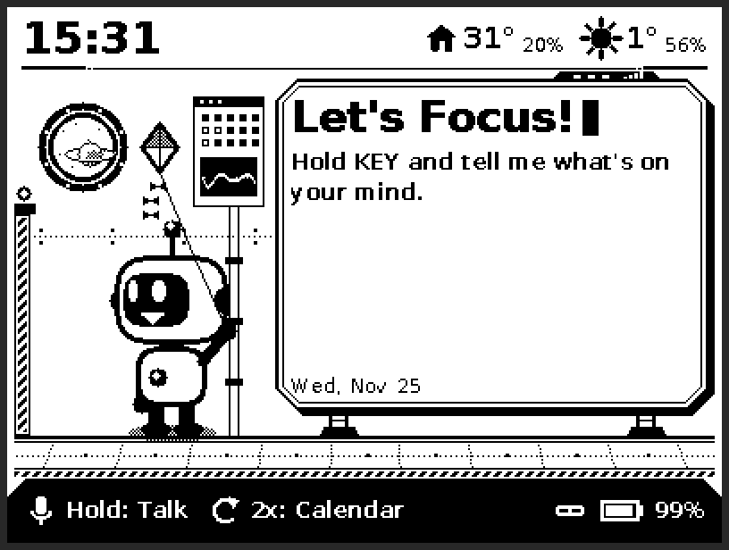
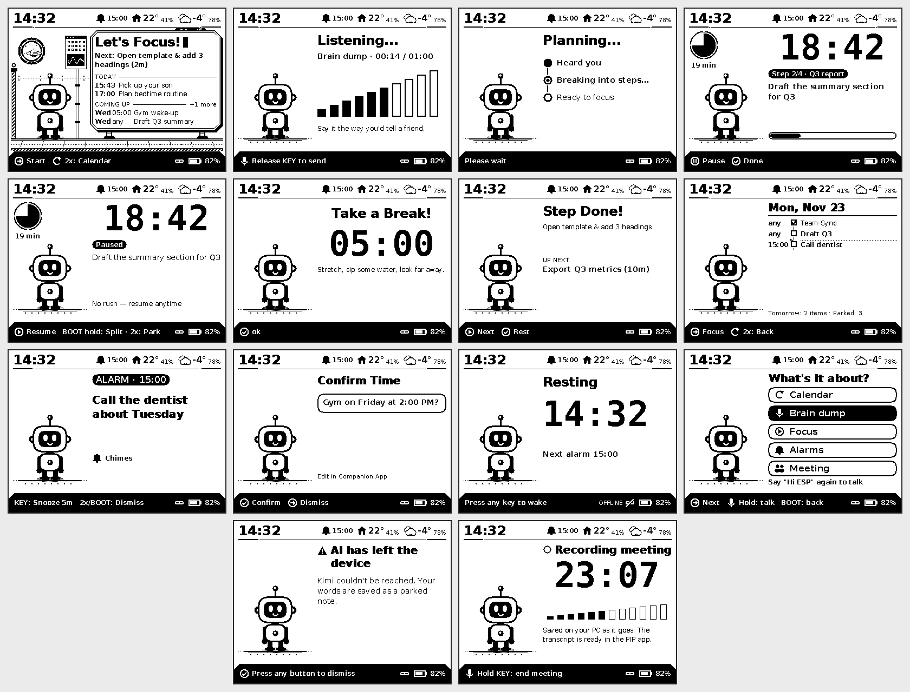

# PIP — an ESP32-S3 focus, activity and meeting companion

*A little bot. A lot of support.* PIP is an ADHD-friendly desk companion built on a Waveshare
**ESP32-S3-RLCD-4.2** board (400×300 reflective 1-bit screen, two buttons, microphone, speaker, battery), paired
with a Windows **companion app**. You tell PIP what's on your mind, by voice or text. It turns that into **one task
of small steps**, keeps time for you on the desk and acts out what you are doing. It also keeps today's calendar,
alarms and reminders, and records and transcribes meetings on your own PC.

<p align="center">
  
  <br><sub>A real capture of PIP's screen (firmware 1.7), scaled 2×. Today's agenda rows on the board have been
  blanked out for privacy.</sub>
</p>

## What it does

- **Brain dump → one lane.** Hold KEY (or say the wake word) and talk, or type in the app. The Kimi planner picks
  *one* task, breaks it into 3–6 concrete steps (the first is a 2-minute starter), parks every tangent for later
  and sets any alarms or reminders you mentioned. Vague times ("Friday afternoon") are always confirmed first.
- **A timer you can feel.** The current step shows as a big countdown and a disc that shrinks like a kitchen timer.
  PIP chimes at 5 minutes left and says "Time to wrap up" at 1 minute, even when it is offline.
- **PIP acts out your step.** It writes in a notebook for "Draft the summary", is on the phone for "Call the
  dentist", flips pancakes, works out, carries a shopping bag… (14 activity types). On the idle screen it plays in a
  small space station with props, and no animation repeats within 2 hours.
- **Rescue, not guilt.** Hold BOOT to cut a step in half when it feels too big. Double-click BOOT to park the whole
  task with its time left. There are no overdue badges or streaks.
- **Today at a glance.** Clock, next alarm, indoor temperature and humidity (PIP's own sensor) and animated outdoor
  weather. The board lists today's items and what's **coming up** in the next 7 days, and double-clicking KEY opens
  a timeline of today.
- **Alarms and reminders.** Alarms can be one-time or weekly, with a chime or a **spoken wake-up** message (Piper
  voices, optionally written by Kimi). Reminders and task start times ping you with a chime and speech, waiting for
  your next break if you're busy.
- **Meetings.** Pick *Meeting* in the voice menu and PIP records with no time limit. The audio is saved on your PC
  as it arrives and transcribed **locally** (faster-whisper) with speaker detection and remembered voices. You can
  also get an optional Kimi summary with decisions and action items, and export as Markdown, TXT, SRT or JSON.
- **Hands-free.** An on-device wake word ("Hi ESP", "Jarvis", "Computer" or "Hi Joy"); the microphone audio stays
  on PIP until it hears the word. Say *"Hi ESP… Meeting"* or *"Hi ESP, alarms, wake me at 7"* to jump straight to
  an activity.
- **Cable or Wi-Fi.** PIP works over USB or your 2.4 GHz Wi-Fi (paired to your PC with HMAC over USB). Firmware
  updates come from the app over either link, and roll back automatically if a new build fails to start.
- **Works unplugged.** PIP keeps the timer, logs finished steps and rings the alarms it already knows. Everything
  syncs when it reconnects.
- **AI cost meter.** Every Kimi call is priced and shown per day and month, with an optional monthly cap that stops
  planning when it is reached.

### The screens



<sub>Rendered by the simulator from the same C code as the firmware, with sample data.</sub>

## Using PIP

### Buttons

| | What it does |
|---|---|
| **KEY click** | Start or pause the timer. On "Step Done!", start the next step. On an alarm, snooze 5 min. |
| **KEY double-click** | Show today's agenda, or go back. On an alarm, dismiss. |
| **KEY hold** (or say the wake word) | Voice message: pick what it's about, then hold KEY again and talk (up to 10 min). |
| **BOOT click** | Mark the step done. On "Step Done!", take a 5-min break. On a question, confirm. |
| **BOOT hold 1.2 s** | Cut the step in half. Nothing is lost: the rest becomes the next step. |
| **BOOT double-click** | Park the task for later, keeping its steps and time left. |
| **KEY hold during a meeting** | End the meeting recording. (Clicks are ignored while recording.) |

### A typical session

1. **Hold KEY.** PIP asks *What's it about?*: **Calendar · Brain dump · Focus · Alarms · Meeting**. Click KEY to move
   the highlight, then hold KEY and speak, and release to send. Hands-free: say the wake word, optionally the
   activity's name, then your message; PIP stops listening after a short pause.
   - *Brain dump:* everything on your mind. PIP picks one task to do now and parks the rest.
   - *Calendar:* "Dentist Thursday at 2", "move gym to Friday morning".
   - *Focus:* "pause", "I need a break", "this step is too big".
   - *Alarms:* "wake me at 6:30 every weekday", "wake me at 5 for the gym with a lady's voice".
2. **Planning takes about 20–40 s.** Steps name the real places and things you mentioned. Say when you'll start
   ("at 2") and the task goes on the calendar, and PIP says "Time to start: …" then.
3. **Click KEY** to start the 2-minute starter, **click BOOT** when it's done, and repeat. A break screen walks you
   through "stretch, sip some water, look far away".
4. **Meetings:** pick *Meeting* and hold KEY. PIP shows REC and the running time until you hold KEY again. Open
   **Meetings** in the app to read who said what, name speakers, fix lines, summarize or export.

### The companion app (http://127.0.0.1:18421)

A React app served by the host and wrapped by a Windows tray app (**PIP Companion**, with optional
*Start with Windows*):

- **Today:** focus timer and steps, today and tomorrow, parked tangents. Drag items between Today, Tomorrow and
  Parked; *Promote* turns a parked thought into steps.
- **Calendar:** Outlook-style month, week and day views. Drag to move, drag an edge to change the length, click an
  hour to add something.
- **Brain Dump:** type or review a plan before saving it.
- **Meetings:** playback, click-to-seek transcript, speaker naming and remembered voices, Kimi summary, export,
  and *Import audio* for recordings made elsewhere.
- **Alarms:** chime or spoken wake-up, voice picker, *Write with Kimi*, preview on the PC, test on the device.
- **Device:** a live copy of PIP's screen, battery and health, Wi-Fi setup and firmware updates.
- **Settings:** Kimi API key and model, AI usage and budget, wake word, voices, weather location, and *Words PIP
  should know* (names and acronyms that help speech recognition and planning).

The full user manual is in [docs/USER_MANUAL.md](docs/USER_MANUAL.md).

## Privacy and data

- **Stays on your PC:** speech-to-text (faster-whisper), text-to-speech (Piper), meeting audio
  (`data/meetings/*.wav`), transcripts, tasks and calendar (SQLite `data/pip.db`). All of this lives under `data/`,
  which is never committed.
- **Sent to Moonshot (Kimi):** the text of brain dumps and voice messages for planning, and meeting transcripts only
  when you press *Summarize*. Audio is never uploaded.
- **Weather:** your chosen city's forecast comes from open-meteo.com.
- **Secrets:** the Kimi API key and the Wi-Fi pairing token are kept in Windows Credential Manager (`keyring`). Your
  Wi-Fi password is sent to PIP once over USB and not stored on the PC.

## Device configuration

### Hardware: Waveshare ESP32-S3-RLCD-4.2

| Part | Details |
|---|---|
| Module | ESP32-S3-WROOM-1-**N16R8**: dual-core Xtensa LX7 (up to 240 MHz; PIP runs at the ESP-IDF default of 160 MHz), **16 MB** QIO flash, **8 MB** octal PSRAM (80 MHz), Wi-Fi 2.4 GHz |
| Display | 4.2″ **400×300** reflective 1-bit LCD over SPI (SCLK 11, MOSI 12, CS 40, DC 5, RST 41, TE 6), no backlight, ≤20 FPS |
| Audio | **ES7210** mic ADC (I²C 0x40) + **ES8311** speaker codec (0x18) on I²S (BCLK 9, MCLK 16, LRCLK 45, DIN 10, DOUT 8), amp enable 46. 16 kHz mono PCM16 |
| Clock and sensor | **PCF85063** RTC (0x51) and **SHTC3** temperature/humidity (0x70) on I²C (SDA 13, SCL 14, 100 kHz) |
| Buttons | **KEY** (GPIO 18) and **BOOT** (GPIO 0) |
| Power | Li-ion battery, voltage on ADC GPIO 4 (÷3 divider, 3.30–4.18 V range), charged over USB-C |
| PC link | USB-C, native USB Serial/JTAG (VID **0x303A** / PID **0x1001**) |

### Firmware

| Setting | Value |
|---|---|
| Framework | **ESP-IDF 5.5.5**, FreeRTOS at 1000 Hz, stack-overflow canaries on |
| Version | `PROJECT_VER` in `firmware/CMakeLists.txt` = `APP_FW_VERSION` in `firmware/main/app_controller.h` (1.7.x) |
| Tasks | Core 0: USB receive, network server, audio, wake word. Core 1: UI (buttons, timer, sensors, animation, display) |
| Memory | Wi-Fi/LWIP buffers in PSRAM, allocations above 4 KB go to PSRAM (internal RAM is kept for drivers) |
| Wake word | ESP-SR **WakeNet9**: Hi ESP (default), Jarvis, Computer, Hi Joy, stored in the `model` partition |
| Wi-Fi link | Station mode, mDNS `pip-xxxx.local` (`_pip._tcp`), one TCP client on port **18422**, HMAC-SHA256 challenge on every connection |
| Updates | OTA with **rollback**: a new image is confirmed after 20 s of healthy running, otherwise the previous slot boots |
| Diagnostics | Core dumps to flash. Uptime, reset reason, heap, battery and link stats are reported to the app |

**Partition table** (`firmware/partitions.csv`, 16 MB):

| Name | Type | Size | Purpose |
|---|---|---|---|
| nvs | data/nvs | 16 KB | settings, Wi-Fi credentials, pairing token |
| otadata | data/ota | 8 KB | which app slot boots |
| phy_init | data/phy | 4 KB | RF calibration |
| ota_0 / ota_1 | app | 3.75 MB each | two firmware slots for updates |
| model | data/spiffs | 3 MB | wake-word models |
| storage | data/spiffs | 4 MB | reserved |
| coredump | data/coredump | 64 KB | crash dumps |

The C core (UI, mascot, gestures, timer, protocol) has no ESP-IDF dependencies. It also builds for the PC as a
**simulator** (`sim_rlcd`) and runs the C test suite with `-Wall -Wextra -Werror -Wconversion`.

## PC requirements

| | Minimum | Recommended |
|---|---|---|
| OS | Windows 10 or 11, 64-bit | Windows 11 |
| CPU | 64-bit x86, 4 cores | 6–8 cores (meeting transcription is CPU-bound) |
| RAM | 8 GB | 16 GB (the voice and meeting models can be loaded at the same time) |
| Disk | ~3 GB (Python env, Whisper `small.en` ≈ 0.5 GB, Piper voices ≈ 60 MB each, app build) | plus ~115 MB per hour of recorded meetings |
| GPU | not needed: speech runs on the CPU (int8) | an NVIDIA GPU with CUDA is used automatically if it works |
| Network | internet for Kimi planning and weather | 2.4 GHz Wi-Fi if PIP should run without the cable |
| Ports | one USB-C data cable | |
| Account | a Moonshot (Kimi) API key; planning stops without it | |

**Software:** Python **3.11+** (tested with 3.13), Node.js **22 LTS** to build the app (tested with 22.15),
ESP-IDF **5.5.5** only if you build firmware yourself. The tray app, installer script and Credential Manager
storage are Windows-specific.

**Tested on:** Windows 11 Home, AMD Ryzen 7 5800H (8 cores), 16 GB RAM, running Whisper on the CPU.

## Getting started (Windows, PowerShell)

**The easy way: the installer.** `PIP-Setup-<version>.exe` installs **PIP Companion** as its own program
(`PIP.exe`, no Python or Node needed). It runs its services itself, opens in its own window and sits in the tray. Your
data goes to `%LOCALAPPDATA%\PIP`. With an NVIDIA graphics card, tick **GPU speech** in the installer or use
**Settings → GPU speech** later (a one-time ~1.3 GB download). Build the installer from source with
`powershell -ExecutionPolicy Bypass -File tools\build_exe.ps1` (output in `build\app\`). To bring over data from a
source checkout once: `& "$env:LOCALAPPDATA\Programs\PIP Companion\PIP.exe" --import-data "<repo>\data"` (before
the first start).

**From source:**

1. Set up Python and build the app:
   ```powershell
   python -m venv .venv; .\.venv\Scripts\pip install -r host/requirements.txt
   ```
   With an NVIDIA GPU, also install the CUDA libraries so speech-to-text runs on the GPU (about 1 GB):
   ```powershell
   .\.venv\Scripts\pip install -r host/requirements-gpu.txt
   ```
   ```powershell
   cd host/desktop_ui; npm install; npm run build; cd ../..
   ```
2. Create the desktop and Start-menu shortcuts (**PIP Companion (dev)**, running from this folder):
   ```powershell
   .\tools\install_windows.ps1
   ```
3. Plug PIP in, open **PIP Companion** and add your Kimi key under **Settings → Kimi API key**. To use Wi-Fi, go to
   **Device → Connection** while the cable is plugged in.

**No board? Use the simulator:**
```powershell
.\.venv\Scripts\cmake -S firmware -B build/host -G Ninja -DPIP_HOST_BUILD=ON -DCMAKE_TOOLCHAIN_FILE=tools/host-toolchain.cmake; .\.venv\Scripts\cmake --build build/host
```
```powershell
.\.venv\Scripts\python tools/launch_desktop.py --sim
```

**Building and flashing firmware:** build with ESP-IDF, then update from the app (**Device → Firmware → Update
PIP**, about 25 s over USB or Wi-Fi). Flash over USB only for first installs, partition changes or recovery:
```powershell
powershell -File tools/idf.ps1 build
```
```powershell
$env:PIP_ALLOW_AUTO_FLASH="1"; .\.venv\Scripts\python tools/flash_board.py; Remove-Item Env:PIP_ALLOW_AUTO_FLASH
```

### Configuration (`.env`, see `.env.example`)

Most preferences are set in the app (saved in `data/settings.json`). Environment variables:

| Variable | Default | Meaning |
|---|---|---|
| `MOONSHOT_API_KEY` | *(empty)* | Kimi key. Normally set in the app and stored in Credential Manager; a value here takes priority |
| `PIP_HOST_PORT` | `18421` | Host service port (loopback only) |
| `PIP_DB_PATH` | `data/pip.db` | SQLite database; meeting audio goes to `meetings/` next to it |
| `PIP_TIMEZONE` | `America/Toronto` | IANA time zone for all scheduling; set your own |
| `PIP_TRANSPORT` | `auto` | `auto` (USB when plugged in, else Wi-Fi), `usb`, `wifi`, `sim`, `none` |
| `PIP_SERIAL_PORT` | | Force a COM port (otherwise found by VID 0x303A / PID 0x1001) |
| `PIP_STT_MODEL` / `PIP_MEETING_MODEL` | `small.en` | faster-whisper models for voice messages and for meetings |
| `PIP_ALLOW_AUTO_FLASH` | `0` | Must be `1` for `tools/flash_board.py` to flash |

## How it fits together

```
 PIP board (C, ESP-IDF 5.5.5)                PC host service (Python, FastAPI)            Companion app (React 19)
 ui_core · mascot · gestures ·      ◄─USB─►  device link · state manager (canonical) ·  ◄──►  REST + WebSocket
 timer · protocol (portable C99)      or     Kimi planner · cost meter · Whisper STT ·         http://127.0.0.1:18421
 + display, audio, RTC, battery,   ─Wi-Fi─►  Piper TTS · alarms · meetings · weather ·
   USB, Wi-Fi, OTA, wake word      (TCP+HMAC) SQLite
 firmware/sim/sim_rlcd  ◄── same protocol over TCP ──►  (simulator for tests and demos)
```

- **Wire protocol v1:** framed binary with CRC16, the same in `firmware/components/usb_protocol` and
  `host/service/protocol/frames.py`.
- **The host owns the canonical state.** The device acts locally first (timer, known alarms, offline log) and
  reconciles when the link returns.
- **Kimi is the only planner.** If it can't be reached, PIP shows "AI has left the device" and your words are parked,
  never silently replaced.

| Folder | Contents |
|---|---|
| `firmware/` | ESP-IDF app (`main/`), components (UI, mascot, protocol, drivers), simulator (`sim/`) |
| `host/service/` | FastAPI host: state, planner, speech, alarms, meetings, device link, storage |
| `host/desktop_ui/` | React + Vite + Tailwind companion app |
| `tests/` | pytest, C tests (CTest), host↔simulator integration, pixel golden images |
| `tools/` | flashing, screen capture, verification, tray app, installer |
| `docs/` | [user manual](docs/USER_MANUAL.md), [design decisions](docs/decisions.md) |

## Verification

| Command | What it checks |
|---|---|
| `.venv\Scripts\python -m pytest tests -q` | host service, planner, alarms and time zones, meetings, simulator integration |
| `ctest --test-dir build/host` | C core: protocol, gestures, timer, JSON, UI and animation (2 h no-repeat and no-jump runs) |
| `build\host\sim_rlcd.exe --render-all artifacts/rlcd` then `python tools/verify_rlcd.py --strict` | 1-bit purity, layout, margins, golden-image diffs |
| `python tools/verify_desktop_ui.py` | Playwright end-to-end tests of the app against the simulator |
| `python tools/check_guardrails.py --skip-builds` | no mocks in production code, no secrets, every protocol frame tested |

For contributors and AI coding agents: start with [AGENTS.md](AGENTS.md).
