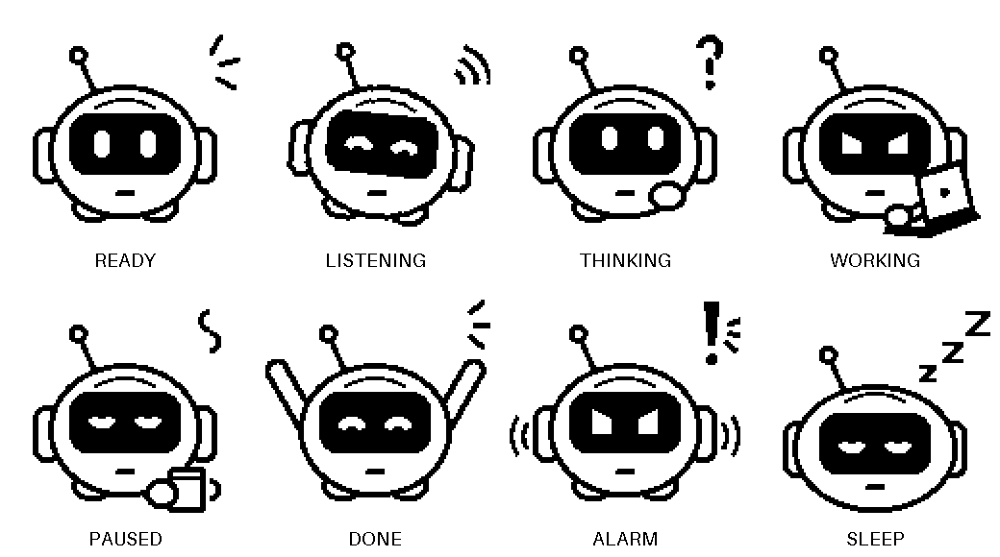

# PIP — Verification Report

_Generated 2026-11-23 22:48 by `tools/generate_report.py`._

## Executive summary

| Track | Result | Detail |
|---|---|---|
| C core (CTest: protocol, gestures, timer, json, ui, app) | ✅ PASS | 100% tests passed out of 6 |
| Python host + integration (pytest, live sim_rlcd) | ✅ PASS | 96 passed, 1 warning in 17.89s |
| Protocol fuzz (Python + C parser, 5000 iter) | ✅ PASS | phase B: 5000 corrupted frames into C parser, 3 reconnects, sim alive |
| RLCD Loop A (pixels, overlap, margins, golden) | ✅ PASS | verify_rlcd: PASS (11 screens, 8 expressions) |
| Desktop Loop B (Playwright E2E, 3 viewports) | ✅ PASS | 6/6 flows, 15 view checks, 0 failures |
| Guardrails (mocks, secrets, -Werror, ruff, mypy, tsc, eslint, trace) | ✅ PASS | guardrails (phase 9): PASS (0 failures, 0 warnings) |
| ESP-IDF v5.5.5 firmware build | ✅ PASS | pip_firmware.bin built |

## Environment & locked assumptions

- **Physical ESP32-S3 attached:** **yes** — flashed and verified over USB (HIL); firmware 1.0.0, I²C 0x18,0x40,0x51,0x70, battery 4158 mV, RTC ok, audio ok
- **Planner:** `LocalRulePlanner` (offline) active — no `MOONSHOT_API_KEY` set. Kimi path covered by mocked-HTTP tests.
- **ESP-IDF:** v5.5.5 installed; `idf.py build` clean. Host build uses zig cc (ADR-002).
- **STT:** faster-whisper `small.en` loads on first voice capture (CUDA if usable, else CPU int8).
- **TTS:** Piper not configured → built-in chimes. Host→device `AUDIO_*_OUT` playback is accepted but not played in v1 (known gap).
- Deviations: see `docs/decisions.md` (ADR-001 … ADR-012).

## Budgets

| Resource | Measured | Budget | |
|---|---|---|---|
| App image (factory 4 MB) | 413 KB | ≤ 2048 KB | ✅ |
| Static DRAM (.bss + .data) | 57.8 KB | ≤ 120 KB | ✅ |
| Free internal heap (live board) | 254 KB | ≥ 120 KB | ✅ |
| RLCD framebuffer | 15,000 B (static assert) | 15,000 B | ✅ |
| Max protocol payload | 4,096 B (DUMP_FB chunk 3,754 B) | 4,096 B | ✅ |

## Visual gallery

PIP expressions: 

### RLCD screens (simulator)

### Captured from the physical board (DUMP_FB)

### Desktop companion

**1440x900**

**900x700**

**480x800**

### Bidirectional sync flows (Playwright + sim_rlcd)

- ✅ desktop->device: brain dump parsed (steps/starter/parked/alarm) and accepted
- ✅ desktop Start -> sim_rlcd RUNNING, framebuffer captured
- ✅ device BOOT click -> step completed in SQLite -> desktop updated live
- ✅ device BOOT hold -> rescue split visible on desktop, zero lost duration
- ✅ sim stopped -> calm Standalone banner within 4 s, form input preserved
- ✅ sim restarted with queued STEP_COMPLETE -> reconciled, revision incremented

## 5-minute physical bring-up checklist

1. Plug the board into USB-C. Flash: `$env:PIP_ALLOW_AUTO_FLASH=1; python tools/flash_board.py`.
2. Capture: `python tools/capture_rlcd.py --prefer-hardware --drive` → compare `artifacts/rlcd/hardware/`.
3. **Optical check (needs your eyes):** landscape orientation, text not mirrored, PIP on the left, black status bar at the bottom, good contrast under desk light.
4. Battery: multimeter across the cell vs. DIAG `batt_mv` (divider ×3, ADR-004).
5. Mic/speaker: run `python tools/launch_desktop.py`, hold KEY ~3 s and speak — Brain Dump shows the transcript; finish a step with BOOT and listen for the 'done' chime.
6. Restore factory demo anytime: `python -m esptool --port COM3 write-flash 0 backups/factory_flash_backup_16MB.bin`.
